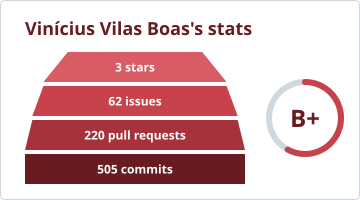
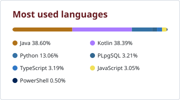
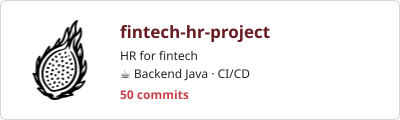

## A bit about Vinícius ⭐

Fullstack developer at **PicPay** 💚 and high school student at [Germinare Tech](https://br.linkedin.com/school/institutojef/).

... btw I use Arch

Check out my blog too :)

## My stack 🧰

<table>
  <tr>
    <td><b>☕ Backend</b></td>
    <td>
      
      
      
      
    </td>
  </tr>
  <tr>
    <td><b>🗄️ Data</b></td>
    <td>
      
      
      
    </td>
  </tr>
  <tr>
    <td><b>📱 Mobile</b></td>
    <td>
      
      
      
    </td>
  </tr>
  <tr>
    <td><b>🌐 Frontend</b></td>
    <td>
      
      
      
      
      
    </td>
  </tr>
  <tr>
    <td><b>🛠️ Tools</b></td>
    <td>
      
      
      
      
      
    </td>
  </tr>
</table>

## Studying now 📓

<table>
  <tr>
    <td><b>⚙️ Low level</b></td>
    <td>
      
      
    </td>
  </tr>
  <tr>
    <td><b>🧮 Algorithms</b></td>
    <td>
      
      
    </td>
  </tr>
</table>

## My GitHub stats ⚙️

  
  

## School projects 🏫

<!-- Cards generated by scripts/update_projects.py from scripts/projects.json -->
<!-- PROJECTS:START -->

  
  
  
  
  

<!-- PROJECTS:END -->

## Where to find me 🔗

