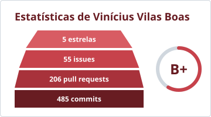
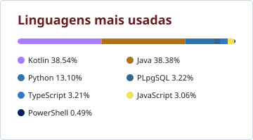
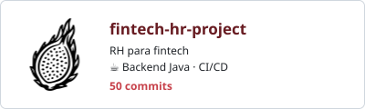

## Um pouco sobre o Vinícius ⭐

Desenvolvedor fullstack no **PicPay** 💚 e estudante do ensino médio na [Germinare Tech](https://br.linkedin.com/school/institutojef/).

... btw I use Arch

Confira também o meu blog :)

## Minha stack 🧰

  
  
  
  
  
  

## Estudando agora 📓

  
  
  
  

## Minhas estatísticas GitHub ⚙️

  
  

## Projetos escolares 🏫

<!-- Cartões gerados por scripts/update_projects.py a partir de scripts/projects.json -->
<!-- PROJECTS:START -->

  
  
  
  
  

<!-- PROJECTS:END -->

## Onde me encontrar 🔗

